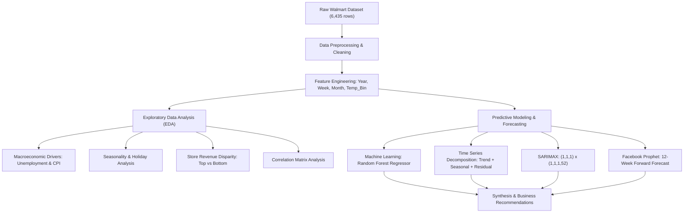

# 🛒 Walmart Sales Forecasting & Inventory Demand Optimization
### *Data Science Capstone Project*


---

## 📌 Executive Summary

**Author:** Ashwin Vishwakarma  
**Domain:** Retail Analytics & Supply Chain Management  
**Focus:** Demand Forecasting, Inventory Optimization, Exploratory Data Analysis, Time Series Modeling (SARIMAX & Prophet), and Machine Learning (Random Forest)

A retail giant with 45 physical store outlets distributed across the United States faces significant challenges in aligning inventory replenishment with consumer demand. Mismatches between demand and supply result in costly stockouts during peak promotional windows or excess inventory carrying costs during off-peak periods.

This capstone project delivers an end-to-end data analytics and predictive forecasting pipeline to:
1. Determine the principal macroeconomic, seasonal, and environmental drivers of weekly store sales.
2. Quantify the revenue disparity across individual store locations.
3. Build robust machine learning and econometric time-series models to accurately forecast weekly sales for upcoming periods.
4. Translate data-driven findings into actionable inventory and supply chain strategies.

---

## 📊 Dataset Overview

The dataset contains historical sales records from **45 Walmart stores** across different regions from **February 2010 to October 2012** (143 weeks per store, totaling 6,435 observations).

### Schema & Attributes

| Feature | Data Type | Description |
| :--- | :--- | :--- |
| **`Store`** | Integer | Store number identifier (1 to 45) |
| **`Date`** | Datetime | Week of sales record (format: DD-MM-YYYY) |
| **`Weekly_Sales`** | Float | Total sales volume for the specified store in that week ($ USD) |
| **`Holiday_Flag`** | Binary | `1` = Holiday week (Super Bowl, Labor Day, Thanksgiving, Christmas), `0` = Non-holiday week |
| **`Temperature`** | Float | Average temperature in the region on the sale week (°F) |
| **`Fuel_Price`** | Float | Regional cost of fuel per gallon ($ USD) |
| **`CPI`** | Float | Prevailing Consumer Price Index (measure of inflation) |
| **`Unemployment`** | Float | Prevailing regional unemployment rate (%) |

*Data Quality Note:* The dataset has **zero missing values** across all 6,435 rows. Extreme outliers in `Weekly_Sales` represent authentic holiday sales surges and Black Friday shopping events, which were retained to prevent distorting peak demand predictions.

---

## 🛠️ Tech Stack & Libraries

- **Language:** Python 3.9+
- **Data Manipulation:** `pandas`, `numpy`
- **Data Visualization:** `matplotlib`, `seaborn`
- **Machine Learning:** `scikit-learn` (`RandomForestRegressor`, `train_test_split`)
- **Econometric Time Series:** `statsmodels` (`seasonal_decompose`, `SARIMAX`)
- **Forecasting:** `prophet` (Facebook Prophet)
- **Environment:** Jupyter Notebook / Google Colab

---

## 🔄 Project Architecture & Workflow



---

## 🔍 Key Findings & Exploratory Data Analysis (EDA)

### 1. Macroeconomic Influences: Unemployment & Inflation
- **Unemployment Impact:** Displays a measurable negative correlation with weekly sales. Stores located in regions experiencing rising unemployment suffer lower consumer footfall and basket sizes due to constricted disposable income.
- **Consumer Price Index (CPI):** Displays a mild negative trend. Inflationary pressure erodes purchasing power, particularly for discretionary merchandise. Distinct store clusters exhibit higher sensitivity to inflation shifts.

### 2. Seasonality & Holiday Spikes
- **Q4 Revenue Surge:** Monthly sales analysis shows that November and December consistently generate the highest revenue of the year.
- **Holiday Drivers:** Special promotional holidays—specifically **Thanksgiving (Black Friday week)** and **Christmas**—produce massive spikes exceeding $2.0M+ in weekly sales per high-performing store, compared to regular-week baselines of ~$1.4M–$1.6M.

### 3. Temperature & Fuel Price Dynamics
- **Temperature:** Binned temperature analysis (5 distinct temperature brackets) reveals that sales stay relatively stable across moderate weather brackets. Cooler weather brackets coincide with higher sales primarily due to the timing of holiday shopping in late autumn and winter.
- **Fuel Price:** Fuel costs show negligible direct linear impact on weekly sales volume.

### 4. Cross-Store Performance Disparity
Substantial divergence exists across store tiers:
- **Top 5 Performing Stores (Cumulative Sales):**
  1. **Store 20:** \$301,397,792.46
  2. **Store 4:** \$299,543,972.24
  3. **Store 14:** \$288,999,911.34
  4. **Store 13:** \$286,517,703.80
  5. **Store 2:** \$275,382,440.95
- **Lowest Performing Store:**
  - **Store 33:** \$37,160,221.96
- **Net Performance Gap:** Over **\$264,237,570.50** difference between highest and lowest stores, indicating that store tiering and regional demand profiling are critical for inventory management.

---

## 🤖 Predictive Modeling & Forecasting

### Model 1: Random Forest Regressor
- **Feature Set:** `Store`, `Holiday_Flag`, `Temperature`, `Fuel_Price`, `CPI`, `Unemployment`, `Year`, `Week`
- **Target:** `Weekly_Sales`
- **Methodology:** 80/20 train-test split; ensemble bagging architecture captures non-linear cross-feature interactions and holiday flags.
- **Result:** Successfully forecasts forward multi-store weekly sales patterns across varied store numbers and seasonal weeks.

### Model 2: Time Series Decomposition & SARIMAX
- **Focus:** Evaluated on benchmark Store 1 weekly sales.
- **Decomposition:** Additive decomposition (`period=52`) isolates:
  - **Trend:** Long-term upward and stabilizing trend lines.
  - **Seasonal:** Repeating 52-week annual cycles with steep spikes at week 47 (Thanksgiving) and week 51 (Christmas).
  - **Residuals:** Random noise effectively captured.
- **SARIMAX Specification:** `order=(1, 1, 1)`, `seasonal_order=(1, 1, 1, 52)`
- **12-Week Forward Forecast (Nov 2012 – Jan 2013):**
  - Accurately captures the holiday ramp-up:
    - 2012-11-23 (Black Friday): **\$1,986,683**
    - 2012-12-21 (Pre-Christmas Peak): **\$2,197,818**
    - 2013-01-18 (Post-Holiday Normalization): **\$1,455,060**

### Model 3: Facebook Prophet
- **Configuration:** Weekly frequency (`freq='W'`), automated changepoint detection, weekly & yearly additive seasonality.
- **Forecast Output:** 12-week horizon with upper and lower confidence intervals (`yhat`, `yhat_lower`, `yhat_upper`). Confirms peak demand during the 2nd and 3rd weeks of December reaching ~\$1.45M baseline across the aggregate trend.

---

## 💡 Strategic Business Recommendations

1. **Seasonal Inventory Stocking (Q4 Buffer):**
   - Implement safety stock ramps starting in **early October** to prepare for the mid-November through late-December surge. Supply chain logistics should expand distribution capacity by 35–45% during weeks 46–51.
2. **Tiered Store Allocation:**
   - Eliminate uniform store inventory distribution. Top-tier stores (e.g., Stores 20, 4, 14) generate nearly **8x the revenue** of bottom-tier stores (e.g., Store 33). High-capacity distribution centers must prioritize replenishment for Tier-1 locations.
3. **Macroeconomic Sensitivity Strategies:**
   - In stores operating in high-unemployment or high-CPI regions, shift inventory mix toward **value brands, private labels (Great Value), and essential commodities**, while reducing exposure to premium discretionary items.
4. **Automated Continuous Forecasting:**
   - Integrate the SARIMAX and Prophet models into automated weekly ERP replenishment pipelines, re-training with rolling weekly sales updates.

---

## 📂 Repository Structure

```text
├── Capstone WALMART PROJECT (1).ipynb   # Comprehensive Jupyter Notebook with EDA, Models & Visuals
├── Walmart DataSet.csv                  # Full historical dataset (6,435 records)
├── requirements.txt                     # Python dependencies
├── .gitignore                           # Git ignore rules for checkpoints and cache
└── README.md                            # Project documentation and summary
```

---

## 🚀 Getting Started

### 1. Clone the Repository
```bash
git clone https://github.com/ashwin0657/Walmart-Project.git
cd Walmart-Project
```

### 2. Create and Activate a Virtual Environment
```bash
# Windows
python -m venv venv
venv\Scripts\activate

# macOS / Linux
python3 -m venv venv
source venv/bin/activate
```

### 3. Install Required Dependencies
```bash
pip install -r requirements.txt
```

### 4. Launch the Jupyter Notebook
```bash
jupyter notebook "Capstone WALMART PROJECT (1).ipynb"
```

---

## 👤 Author

- **Ashwin Vishwakarma**
- **GitHub:** [@ashwin0657](https://github.com/ashwin0657)
- **Project Repository:** [Walmart-Project](https://github.com/ashwin0657/Walmart-Project.git)

---

## 📄 License
This project is open-source and available under the [MIT License](LICENSE).
